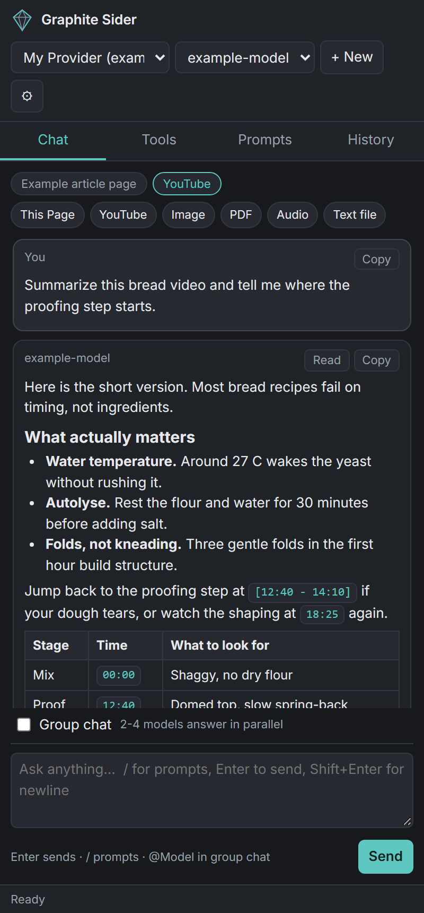
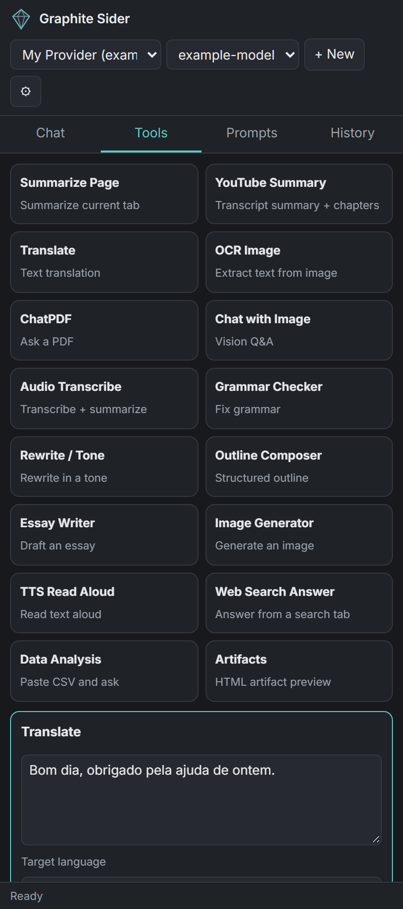
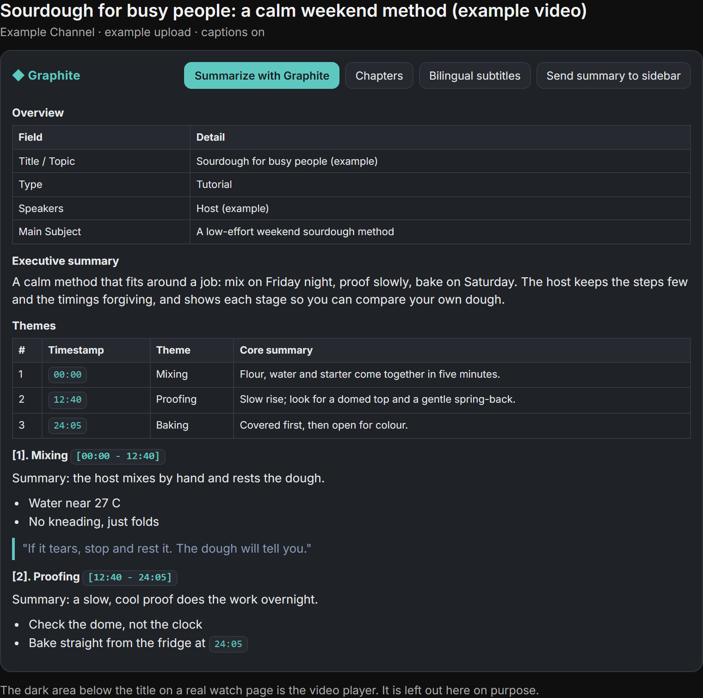
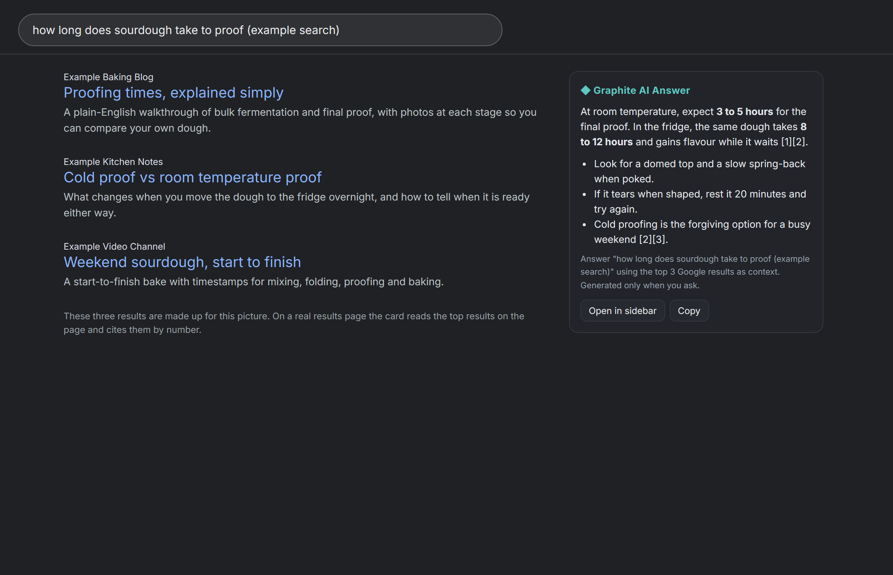
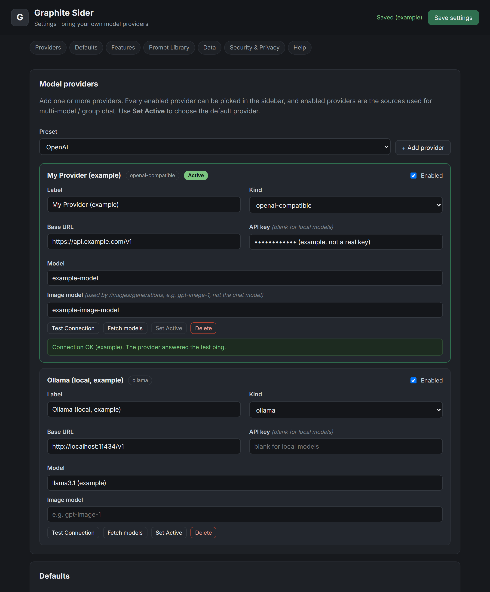
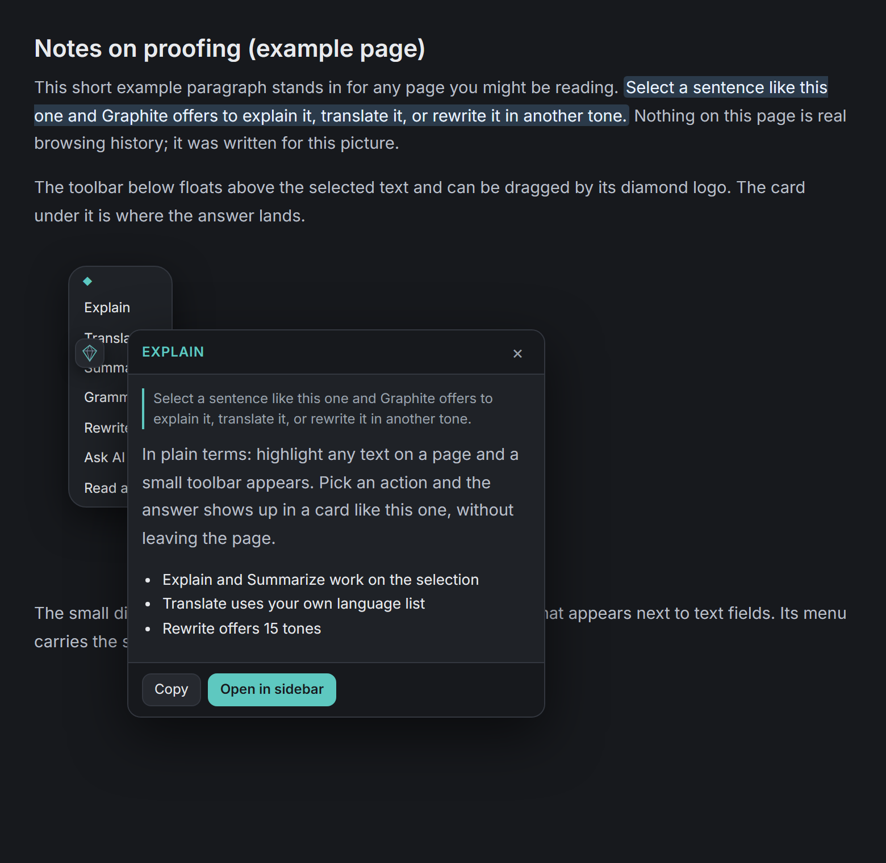

<!-- prettier-ignore -->

# Graphite Sider: AI Sidebar (BYO API)

*An AI sidebar for Firefox that runs on your own API keys*

[Features](#features) • [Screenshots](#screenshots) • [Install](#install) • [Setup](#setup) • [Privacy](#privacy) • [Troubleshooting](#troubleshooting)

Graphite Sider puts an AI chat panel in the Firefox sidebar and answers to the API keys you paste into its Settings. Add a provider, pick a model, and the sidebar talks to that provider directly. There is no Graphite Sider server in the middle, no account to create, and nothing to top up.

OpenAI, Anthropic, OpenRouter, Groq, DeepSeek, Together, Fireworks, Mistral, and xAI have presets, and any other gateway that speaks the OpenAI or Anthropic API shape works as a custom provider. If you would rather keep everything on your machine, point it at Ollama or LM Studio on localhost and the API key becomes optional.

> [!NOTE]
> Your keys and settings live in Firefox local storage on your machine. The only address the extension calls is the base URL you typed into Settings.

## Features

- **Sidebar chat** with streaming answers. Keep several providers on file, and send one prompt to a few models at once when you want to compare replies.
- **Page chat.** Summarize the page in the current tab or ask questions about its readable text. With text selected, the same actions work on the selection.
- **YouTube summaries** built from the full video captions (long videos included), with headings and themes, chapters, and subtitle translation. Every timestamp in an answer is a button that seeks the player, and a range seeks to its start. Slow or reasoning-heavy models show a waiting state while they think instead of dropping the connection, and an answer the provider cut off at its length limit is flagged as truncated.
- **Writing help anywhere.** Highlight a draft and rewrite it in one of 15 tones, shorten it, expand it, or fix the grammar. The toolbar that appears is a row of icons with the names on hover, Copy first and a Close (×) button last to dismiss it without losing your selection. Drag it out of the way by the grip handle at its left end, or by the empty space between icons. A small diamond icon next to text fields opens the same menu.
- **Search answers** in the right rail on Google, Bing, and DuckDuckGo. The card stays idle until you press Generate, so normal searches cost nothing.
- **Translation with your own language list.** The picker offers the languages you keep in Settings, one per line, so Brazilian Portuguese is there if that is the Portuguese you read.
- **A tools grid** for the one-off jobs: OCR an image, chat with a PDF or a picture, transcribe audio, generate an image with a separate image model, read text aloud, outlines, essays, mind maps, CSV questions, and HTML artifacts.
- **Editable prompts.** Built-in prompts sit behind a dropdown in Settings. Pick one, change the wording in the editor, and that version runs everywhere, YouTube summaries included. Your own prompts live in the same place.

## Screenshots

The pictures below are renders of the extension interface with example text typed in. No real pages, keys, or accounts appear in them. Click one to see it at full size.

|  |  |  |
| --- | --- | --- |
| Sidebar chat. Timestamps in the answer seek the player. | The tools grid, Translate open on Portuguese (Brazil). | The summary panel under a YouTube video. |
|  |  |  |
| The answer card in the right rail of a results page. | Settings, where providers and models live. The key field is filler text. | The toolbar that appears when you select text. |

## Install

Firefox 140 or newer is required. The extension declares what it can send to your provider, and Firefox only shows that consent prompt on 140 and up.

From AMO: install it from the listing at https://addons.mozilla.org/en-US/firefox/addon/graphite-sider-ai-sidebar-byo-/

From source:

1. Clone this repo.
2. Open `about:debugging` in Firefox, choose This Firefox, then Load Temporary Add-on.
3. Pick `extension/manifest.json`.

> [!NOTE]
> Temporary add-ons vanish when Firefox restarts. For everyday use, install the signed build from AMO.

To package an XPI yourself, run `python tools/build-xpi.py`. It writes `dist/graphite-sider-<version>.xpi` with `manifest.json` at the root.

## Setup

1. Open Settings from the gear in the sidebar, or from the extension entry in `about:addons`.
2. Add a provider from a preset, or choose Custom and enter a base URL, then paste your key.
3. Press Test Connection.
4. Open the sidebar with `Ctrl+Shift+Y` and start asking.

Three fields are worth knowing about. Image model is separate from the chat model and only matters if your gateway can generate images. Active model override replaces the provider default for chat without editing the provider. Max tokens is the per-reply length cap sent to your provider, and the value you set is the value that goes out, for sidebar chat, YouTube summaries, chapters, and subtitle translation alike. Leave it at 0 (or blank) and no cap is sent, so your provider uses its own default. If a gateway silently substitutes a smaller default of its own when the field is omitted, set the number yourself.

For a local model, run Ollama with `OLLAMA_ORIGINS=*` so the extension origin is allowed, add the Ollama preset, and leave the key blank.

## Privacy

Keys stay in `browser.storage.local`. They go out only as an authorization header to the provider you configured. Page text, selections, drafts, captions, and search queries travel to that same provider, and only when you run an action such as Summarize, Translate, or Generate. Nothing runs in the background and nothing phones home. With Ollama or LM Studio, all of it stays on your machine.

The extension never reads another service's session or cookies. It calls official APIs with keys you paste in yourself.

> [!WARNING]
> The Settings export file contains your keys in plain text. That is what makes it handy for moving to another machine, and it is also why it belongs somewhere private.

## What it does not do

- No sync and no usage dashboard, because there is no server. Settings move between machines only when you export and import them yourself.
- No accounts, plans, or credits. Your provider bills you, and it bills you for the calls you made.
- No hosted agent features that would need a backend of their own, and nothing that automates your desktop.

## Project layout

| Path | What it holds |
| --- | --- |
| `extension/manifest.json` | MV2 manifest, sidebar action, content scripts, permissions, data collection declaration |
| `extension/background.js` | Message router, context menus, streaming chat port |
| `extension/lib/` | Providers, storage, prompts, YouTube transcript and PDF helpers |
| `extension/sidebar/` | The sidebar panel |
| `extension/content/` | Page toolbar and cards, the YouTube panel, the search answer card |
| `extension/options/` | The Settings page |
| `screenshots/` | The pictures above |
| `tests/` | Dependency-free Node checks (`node tests/smoke.test.js`, `node tests/manifest.test.js`) |
| `tools/` | `build-xpi.py`, which packages the extension into `dist/` |

No build step and no dependencies. The files in `extension/` are the source, exactly as shipped.

## Keyboard shortcuts

| Shortcut | Action |
| --- | --- |
| `Ctrl+Shift+Y` (`MacCtrl+Shift+Y` on macOS) | Open or close the sidebar |
| `Alt+Shift+S` | Summarize the current page |
| `Alt+Shift+T` | Translate the current selection |

## Troubleshooting

- **Reload old tabs after an update.** YouTube and search tabs opened before an update still run the old content script. Reload the tab and the new one takes over.
- **Provider errors are shown as returned.** If your gateway answers HTTP 503, that text is what you see. The extension does not hide it behind a silent retry.
- **Slow models that look "disconnected."** The panel distinguishes a dead background connection from a slow provider. Reasoning models can take a minute or more before the first answer text; while the provider is still working you see a waiting state, and only a genuinely stalled provider (no activity for 10 minutes) reports that it stalled.
- **Summaries or replies that end mid-sentence.** Your provider stopped at its output limit. Raise Max tokens in Settings (see Setup), or leave it at 0 and check what default your gateway applies. A summary that was cut this way is marked as truncated.
- **The sidebar sits on the left.** Firefox decides which side the sidebar uses. Move it with Firefox's own sidebar menu; an extension cannot set the side itself.
- **Ollama refuses the connection.** Start it with `OLLAMA_ORIGINS=*` and leave the API key blank.
